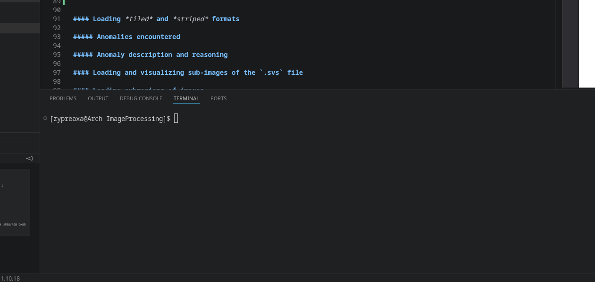
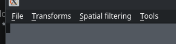
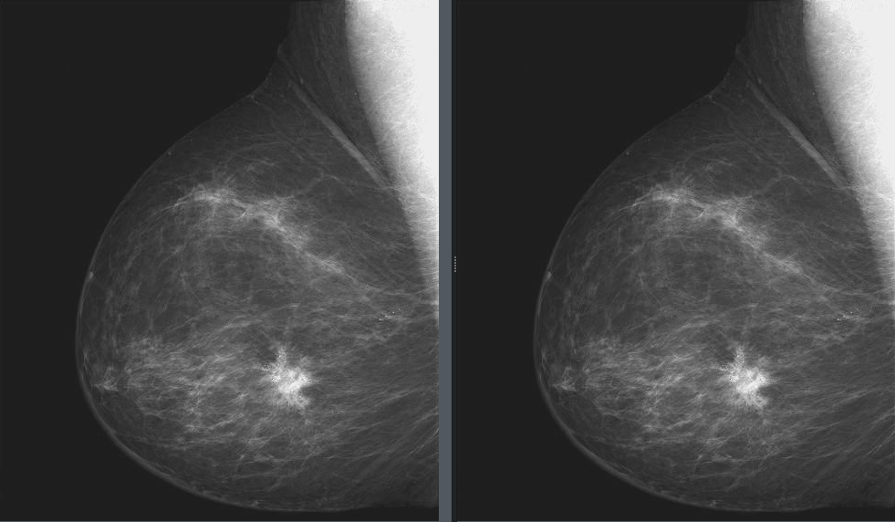
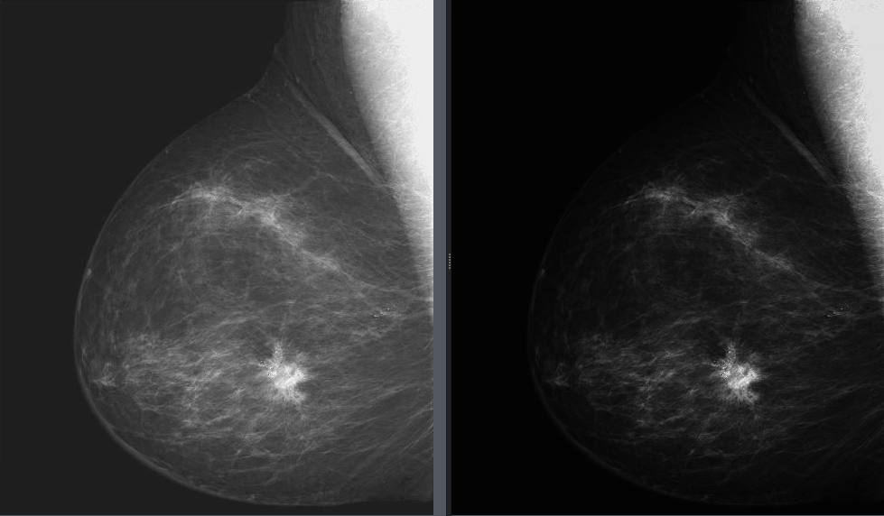
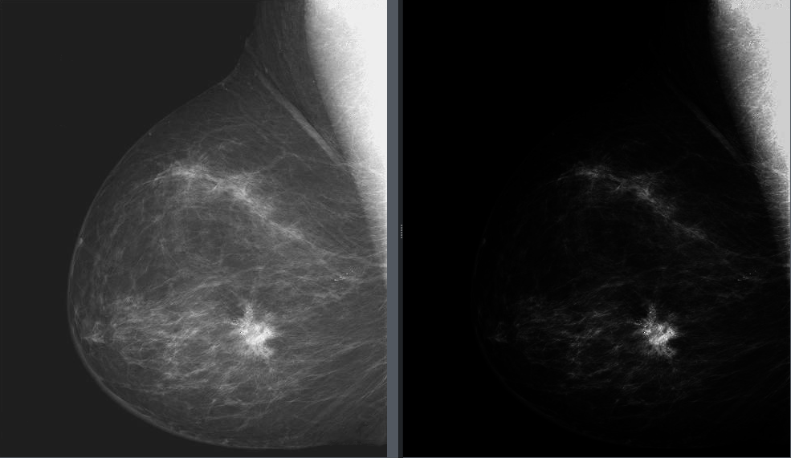
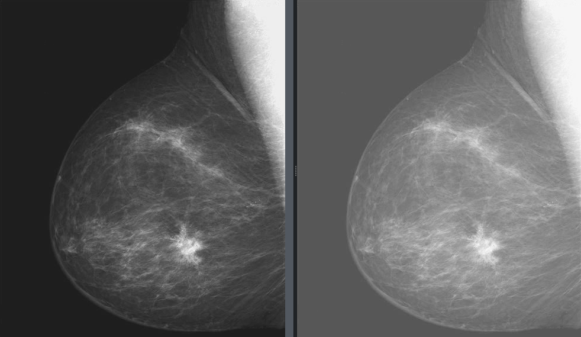
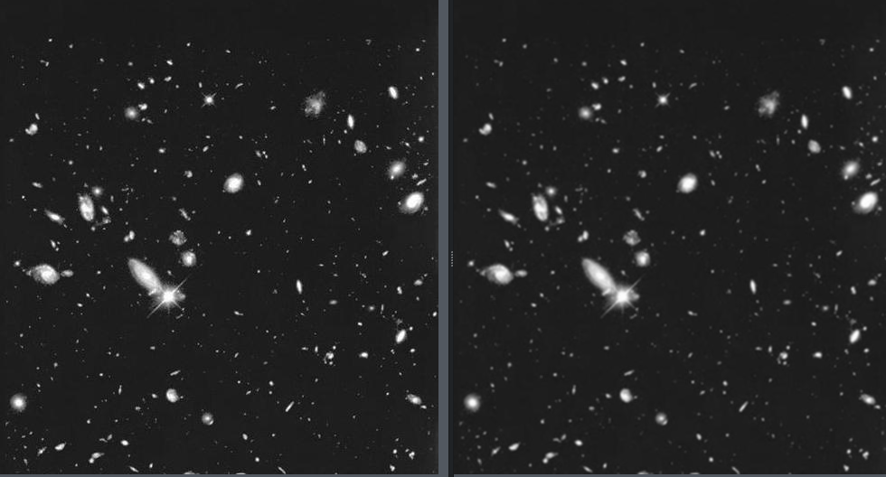
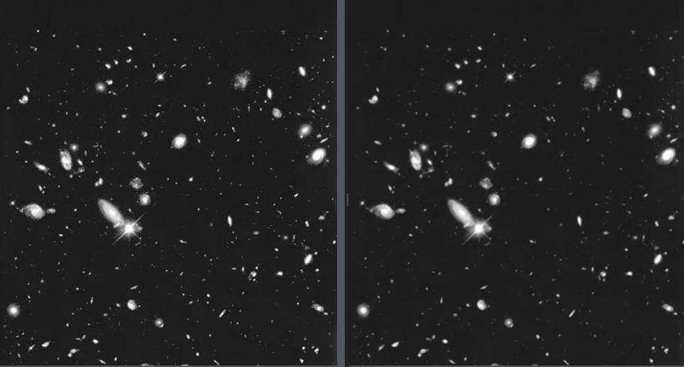
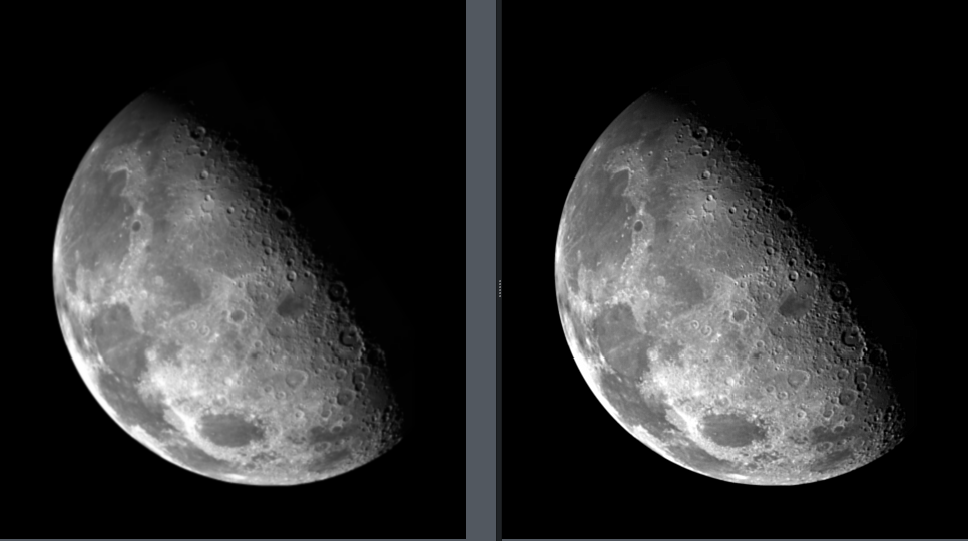
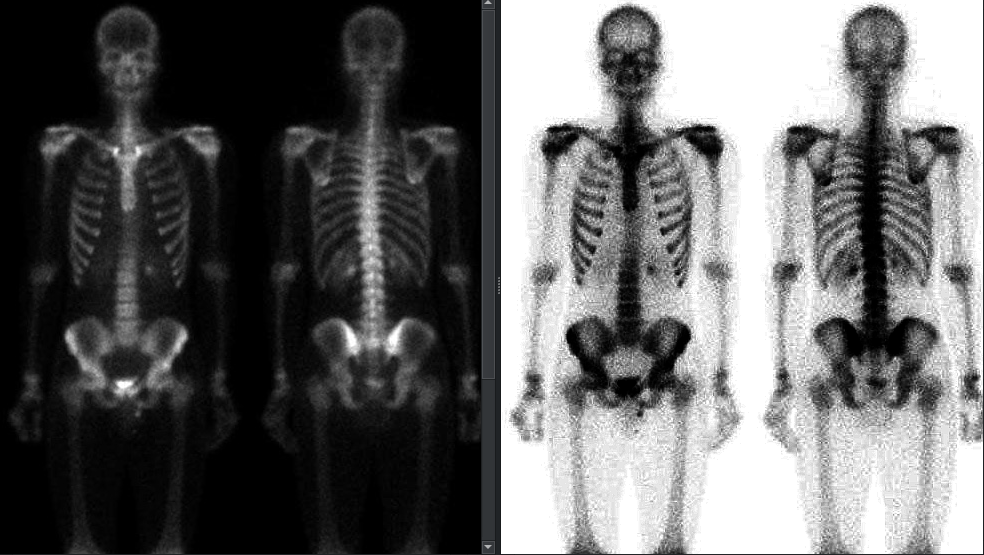

# Assignment Overview
Digital image processing is the use of computer algorithms to manipulate, analyze, and process digital images represented as a grid of pixels.

The aim of this project is to get a grasp on the core principles of how digital image processing works in practice, how regular filters, for example, negation, are constructed through code, and gain practical experience in reproducing already existing methods of image manipulation.

# Code Limitations
This project is built upon a premade base, a collection of files that is usually called a "code skeleton", which was the scaffolding which allowed us to focus on image analysis and manipulation without the need to also create the interface ourselves.

Since I study programming-adjacent modules, I used C++ as my coding language of choice for this project.

## C++
C++ is a high-performance, general-purpose programming language developed by Bjarne Stroustrup at AT&T Bell Labs in 1979 as an extension of the C programming language. Often described as a "middle-level" language, it bridges the gap by providing the raw speed and direct hardware control of low-level languages alongside the abstraction and structural advantages of high-level languages. Code snippets will be provided as examples over the course of this document.

# Assignment Details
This assignment is split into three parts. This is the first of the three reports that will be covering this project.

Everything is separated into different parts, which are all separated in this document, shown by different number sectioning.

## Image Loading
To get a better practical understanding of different language formats, their memory layout and how to combine and manipulate this information, tasks 3.1.1 - 3.1.3 were completed.

### Image Investigations
Tiffinfo displays information about files created according to the Tag Image File Format, Revision 6.0. By default, the contents of each TIFF directory in each file is displayed, with the value of each tag shown symbolically (where sensible). In short - it shows metadata of a `.tif` file, which can be seen in (@fig-tiffokidney1).

{#fig-tiffokidney1}

The syntax for image investigation can be seen in (@lst-tiffinfo). However, the options operator can be omitted if only general data is needed.

``` {#lst-tiffinfo .bash lst-cap="tiffinfo syntax"}
tiffinfo [option] info.tif
```

One interesting thing about this command, at least for me, was that `.svs` files can also be investigated.

However, since these files are most commonly digital pathology slides, which have multiple layers, the output also shows data of multiple images. An snippet of one layer's metadata is shown in (@fig-tiffinfosvs).

{#fig-tiffinfosvs}

I was not aware that pathology slides can be so massive, but a simple search had shown that they can commonly be up to 5GB, and if fully opened, it can take up towards 100GB of RAM. It is one of those interesting facts that made me a lot more curious about this subject as a whole.

### Image loading using `libtiff`
To load the provided image handouts, the previously mentioned code skeleton was used. The code skeleton was able to run nearly without any modifications, only a couple little additions were needed to make it run on my device. The project was also tested on a Windows device, so there should not be any problems between platforms whatsoever.

#### Guide to starting and navigating the program
If VS Code is used, the program can be started through the terminal.

{#fig-terminal}

Once the project is opened in the IDE, a console window should be opened at the bottom section of the window (@fig-terminal). If it is not present, **Ctrl+Shift+`** will open a new terminal session. 

First, clean both `/imagelib` and `/viewerqt5` directories with the `make clean` command to clear any previous compiled files. Then, run `make` in the `/imagelib` directory. It will be required to run `qmake` and `make` in that order in the `/viewerqt5` directory.

After taking the previously mentioned steps, simply navigating to the ```viewerqt5``` folder and running the ```viewer``` file (@lst-launch) with the `./viewer` command will launch the viewer that will be used for further image investigation.

```{#lst-launch .bash lst-cap="Command for running the viewer"}
cd viewerqt5 && ./viewer
```

After executing the ```viewer``` file, you should be presented with the main QT viewer window.

All functions and transformations can be accessed through the toolbar (see @fig-toolbar) in the top portion of the window.

{#fig-toolbar}

There is a dedicated button for each transformation and function. The specific location of it will be described under the corresponding part of this report.

#### Loading *tiled* and *striped* formats
The first step is only to open the images without needing to modify them. However, since ```.tif``` format images are separated into tiled and striped formats, you cannot simply render the image pixel-by-pixel.

Withing the code itself, the class of TiffLoader needed to have defined methods that could fetch the metadata of the full image first to understand how to parse it. 

There are 4 "getter" methods defined (see @lst-getters), which are used to get the dimensions of the full image, get the number of channels that it has associated with it (one channel would mean greyscale. Three generally means RGB), and Bits Per Channel (BPC), which in simple terms defines how deep each color channel is. The more bits/channel, the broader the range of shades that particular color can be defined in.

```{#lst-getters .cpp lst-cap="Getter functions of TiffLoader class"}
unsigned long getWidth() const {return _width;}
unsigned long getLength() const {return _length;}
unsigned long getChannels() const {return _channels;}
unsigned long getBPC() const {return _bpc;}
```

Striped images are made up of separated *strips*, which need to be read one-by-one in order, and combined into one image. It is generally quite a simple process: iterating over each stripe, pixel by pixel, and adding them to one matrix of pixels in a row creates the full image (see @lst-loadstrips).

```{#lst-loadstrips .cpp lst-cap="Code of the striped image loader function"}
unsigned char* TiffLoader::loadStrips(){
	for(tstrip_t i=0; i<nStrips; i++){
		//actual code goes here
		tsize_t bytes = TIFFReadEncodedStrip(_tiff, i, buffer, -1);
};
```
As for tiled images - the TIFF stores the image itself as a grid of smaller images, called *tiles*. This function reads each tile, checks where that tile belongs in the final image, and copies it's rows into one large continuous buffer, which is what the final image is constructed from. A smaller snippet of this function can  be seen below. (See @lst-loadtiled)

```{#lst-loadtiled .cpp lst-cap="Code of the tiled image loader function"}
unsigned char* TiffLoader::loadTiles(){
		
		for(ttile_t i=0; i < tilelength; i++) {

			if(destY + i >= _length)
				break;

			// pointer to row INSIDE the tile
			unsigned char* tilerowptr = buffer + (i * tilewidth * bytesperpixel);

			// pointer to the row in the final image
			unsigned char* destrowptr = data + ((destY + i) * _width * bytesperpixel);
			destrowptr += destX * bytesperpixel;

	}
	delete[] buffer;
	return data;
};
```

##### Anomalies encountered
There was generally little unexpected behavior with this part of the assignments. All images were rendered, and they all looked seemingly faultless, if not a little strange-looking in some cases. Since most of the handout files are medical pathology images, the strangeness was anticipated.

One thing I did not expect was for the ```TMA2-V2.tif``` file to actually have two layers instead of one like the rest. However, I do not consider this unusual or anomalous, only unexpected.

#### Loading and visualizing sub-images of the `.svs` file
The implementation of opening `.svs` format files was not built as a separate function on it's own, but directly into the `openFile()` function. 

The function checks if the file contains more than one directory, and if the answer is yes, it allows you to pick which directory you wish to load. They are all listed, so no guess-work is required from the user.

Looking back, it may have been a better call to split it into it's own `.svsLoader()` function, however, it does not seem to cause any notable issues.

```{#lst-svs .cpp lst-cap="Snippet of the openFile() function containing selection of directories."}
_dirCount = TIFFNumberOfDirectories(_tiff);
			std::cout<<"Tiff DIR count: "<< _dirCount << std::endl;
			if(_dirCount > 1 | _dirCount < 0) {
				int input;
				while(true) {
					std::cout << "This file contains multiple directories (0-"
					<< (_dirCount - 1) << "). Pick a directory: " << std::endl;
					std::cin >> input;

					// validation
					if(!std::cin) {
						std::cin.clear();
						//std::cin.ignore(10000, "\n");
						std::cout << "Error. Please select a valid directory index.\n";
						continue;
					}
					if(input < 0 || input >= _dirCount) {
						std::cout << "Directory does not exist. Please try again.\n";
						continue;
					}
					break; // valid choice hurray
				}
```

#### Loading subregions of images


### Image combination
As we have received three files, each containing only a single channel's worth of of information, we needed to combine them into one singular RGB image.

The code for this is quite simple. The dimensions of the *red* image are taken, and used as the final dimensions for the RGB image.

Using the dimensions for the *red* image in this case is arbitrary, since all three are of the same dimensions. In the following versions, this part of the code will be changed to abort the combination process if the images are of different dimensions.

Since the full function is quite short, the full function can be seen in the list below. (See @lst-rgb)

```{#lst-rgb .cpp lst-cap="Function for combining single channel images into an RGB output."}
Image<>* ImageProcessor::combineRGB(
    Image<>* red,
    Image<>* green,
    Image<>* blue
)
{
    if (!red | !green | !blue) {
        return nullptr;
    } // checking for errors

    unsigned long width = red->getWidth();
    unsigned long height = red->getHeight();
    unsigned long bpc = red->getBpc(); // this assumes that all 3 images are the same size
    unsigned long channels = 3;

    unsigned char* data = new unsigned char [width * height * channels * (bpc/8)];

    for (unsigned long y = 0; y < height; y++) {
        for (unsigned long x = 0; x < width; x++) {
            unsigned long idx = (y * width + x) * channels; // this turns the pixel coordinates from a 2D array into a 1D index
            data[idx] = red->getImageData()[y * width + x]; // R
            data[idx+1] = green->getImageData()[y * width + x]; // G
            data[idx+2] = blue->getImageData()[y * width + x]; // B
        }
    }

    Image<>* out = new Image<>(width, height, channels, bpc, data);
    return out;
};
```
I would like to note that after selecting the three images through the pop-up prompt, a fourth one will be displayed. This is for choosing a destination for saving the file. You may freely cancel the save process, it will not return errors. It will simply allow you to see the combined result in the viewer.

If you choose to save the image, it will be saved as a separate file on your device.

## Intensity Transformations

### Power law for intensities (disregarding constant c)
Since two images can be displayed at once in this version of this project, the image seen on the left will always be the original image opened besides the output of the transformation on the right.

The implementation of the power law of intensities (disregarding the constant c) will no longer be included in the report, as the code from this point on will become repetetive.

As the formula itself for power negation is simply raising the pixel's value by the power of γ, which is a chosen number, I expect the images to become much higher in contrast between the two different bounds of the pixel intensity. For example, raising a pixel with the value of 1 by a γ of 3 would not change it's value at all. However, the higher the value, the more extreme the change would be. I would expect the higher values to become a lot more pronounced, while the darker values stay dark. Completely black regions would remain unchanged.

The results with different gamma values for the `breast_digital_xray.tif` image are listed below. (See @fig-gamma1 - @fig-gamma3)

{#fig-gamma1}

{#fig-gamma2}

{#fig-gamma3}

In reality, the true answer was a little more complicated that I previously thought.

As the γ value can be set at a number that is *below* 1, for example, 0.1, raising any number to that power will have a completely different effect. In this case, something like a γ value of 0.5 would noticeably brighten the image without making it lose all contrast.

One issue I encountered while implementing this function was the γ value being defaulted to 0 when the actual input was a float number below 1, which would turn the entire image white. That was remedied by using **`std::pow()`** instead of the **`^`** operator, which I learned forces every equation into an XOR operation. The successful application of this fix can be seen in the figure below. (See @fig-gamma0.5)

{#fig-gamma0.5}

### Piece-wise linear intensity transformations
For Piece-wise linear intensity transformations, two separate functions were implemented: one for histogram stretching, and one for thresholding. I would like to note that the histogram stretching function is done through the function named `Piece-wise linear`.

The `Piece-wise linear` function equalizes pixel values in three specific ranges: the dark pixels become even darker, the pixels in the mid-range get altered with a slope of 1/3, which increases the contrast in this range, and the pixels in the high-end of the range are mapped to a compressed intensity range. And example transform output of the `kidney.tif` file was used. (See @fig-pw1)

{#fig-pw1}

The `Thresholding` function behaves like a binary separator - pixels above a certain value are assigned a way higher value, while pixels below a certain value get bumped down to a very low value. The same kidney image was used as an input for comparison. (See @fig-thresholding)

{#fig-thresholding}

### Histogram calculation for grayscale images
As the histogram container was already implemented into the code skeleton, minimal changes were made to show accurate histograms for opened and transformed images. They are automatically displayed below every opened and transformed image. The visual output of what a histogram looks like can be seen in the next segment.

### Histogram equalization

### Lookup table intensity transformations

## Spatial Filtering and Multistep Image Processing

### Image classes for pixel intensities

#### Methods of conversion
For converting images between two separate types of image arrays, functions `toFloat()` and `to8bit` were implemented. 

The `toFloat()` function first retrieves the sample size and the standart metadata, just like any other function in this project. Then, for each sample in the image, the pixel is converted to a a floating-point value between 0 and 1. (See @lst-tofloat)

```{#lst-tofloat .cpp lst-cap="toFloat() function code."}
Image<float>* ImageProcessor::toFloat(Image<uint8_t>* img8) {
    size_t width = img8->getWidth();
    size_t height = img8->getHeight();
    size_t channels = img8->getChannels();
    unsigned long bpc = img8->getBpc(); 

    size_t nSamples = width * height * channels;

    uint8_t* src = img8->getImageData();
    float* dst = new float[nSamples];

    for (size_t i = 0; i < nSamples; ++i) {
        dst[i] = static_cast<float>(src[i]) / 255.0f;
    }

    unsigned long floatBpc = 32;
    return new Image<float>(width, height, channels, floatBpc, dst);
}
```
The range of the pixel gets clamped to [0, 1], and a new `Image<float>` is returned.

The conversion to 8-bit is done by the `to8bit()` function.

The process is very similar. The metadata is retrieved, and the value is multiplied by 255. The range of the value get's clamped to [0, 255], and the data is bundled together and passed as an output `Image<uint8_t>`. (See )

```{#lst-to8bit .cpp lst-cap="to8bit() function code."}
Image<uint8_t>* ImageProcessor::to8bit(Image<float>* imgf) {
    size_t width    = imgf->getWidth();
    size_t height   = imgf->getHeight();
    size_t channels = imgf->getChannels();
    size_t nSamples = width * height * channels;

    float* src = imgf->getImageData();
    uint8_t* dst = new uint8_t[nSamples];

    for (size_t i = 0; i < nSamples; ++i) {
        float v = clamp(src[i], 0.0f, 1.0f);
        int rounded = static_cast<int>(std::round(v * 255.0f));
        dst[i] = static_cast<uint8_t>(clamp(rounded, 0, 255));
    }

    unsigned long outBpc = 8;
    return new Image<uint8_t>(width, height, channels, outBpc, dst);
}
```

I would like to note that both of these functions take the other function's output type as the required input type. This way, the conversion does not require any extra in-between steps.

### Image blurring by spatial filtering
For image blurring, a `lowpass()` function was created. This function takes the neighborhood of the pixel, which would be the eight pixels surrounding it, and changes the value of the center pixel to the average of it's neighbors. This algorithm smooths out the image, which results in a blurred output. An example of this function's output can be seen below. (See @fig-lowpass)

{#fig-lowpass}

The `median()` function was also introduced, which takes the median of the neighborhood instead of of the average. The same input image was used for comparison. (See @fig-median)

{#fig-median}

### Numerical approximations of derivative operators
The central difference formula can be implemented using a kernel:
$K_x = \begin{bmatrix}0 & 0 & 0\\-1 & 0 & 1\\0 & 0 & 0\end{bmatrix}$ 

If you apply this kernel to every pixel in the image, you will get an approximation of the horizontal derivative at every location.

Similarly for the vertical derivative:
$K_y = \begin{bmatrix}0 & -1 & 0\\0 & 0 & 0\\0 & 1 & 0\end{bmatrix}$ 

The sign depends on the coordinate convention and how convolution is implemented. Some implementations may reverse the kernel, changing the sign but not the magnitude.

#### Magnitude of gradient

The gradient magnitude combines two partial derivatives:

$\nabla I = \begin{bmatrix} \frac{\partial I}{\partial x}\\\frac{\partial I}{\partial y} \end{bmatrix}$

It's magnitude is calculated as:

$|\nabla I| = \sqrt{(\frac{\partial I}{\partial x})^2 + (\frac{\partial I}{\partial y})^2}$

In simple terms, it measures how strongly the image intensity changes in any direction.

Flat regions have small gradient magnitudes because the intensity between neighboring pixels barely changes. Edges can have large gradient magnitudes because their intensity can change very rapidly.

It can be implemented by applying the horizontal and vertical derivative filters separately, then combining their outputs using the formula listed above.

Note the the magnitude calculation is non-linear; the individual derivative operations are linear filters.

#### Laplacian

The Laplacian measures the sum of second derivatives: 

$\nabla^2 I = \frac{\partial^2 I}{\partial x^2}+\frac{\partial^2 I}{\partial y^2}$

A common 3x3 approximation is: $\begin{bmatrix}0&1&0\\1&-4&1\\0&1&0\end{bmatrix}$

This kernel compares the center pixel with it's direct neighbors. It responds to changes in intensity, and is commonly used for edge detection and image sharpening.

Interestingly, another common convention uses the negative of this kernel, with 4 in the center and -1 around it. This specific method was used as the intermediate Laplacian calculation in the next segment of the report.

### Image sharpening using an intermediate Laplacian calculation
An intermediate Laplacian calculation was implemented for this excercise. Mathematically, the code can be expressed with an equation:

$\nabla^2I(x,y)=\begin{bmatrix}I(x+1,y)+I(x-1,y)\\+I(x,y+1)+I(x,y-1)\end{bmatrix}-4I(x,y)$

More conventionally, it can be written as a scalar equation:

$\nabla^2I(x,y)=I(x+1,y)+I(x-1,y)+I(x,y+1)+I(x,y-1)-4I(x,y)$

In these formula, $I(x,y)$ is referring to the intensity of the current pixel.

This is an approximate of the continuous 2D Laplacian:

$\nabla^2I=\frac{\partial^2I}{\partial x^2}+\frac{\partial^2I}{\partial y^2}$

The resulting kernel corresponds to the previously noted common 3x3 approximation, which can be expressed through a kernel:

$K_{lap}=\begin{bmatrix}0&1&0\\1&-4&1\\0&1&0\end{bmatrix}$

The line `out.r = out.b = out.g = imgf->getPixelValue(x, y) - c * lapval;` performs Laplacian sharpening, using the original image and subtracting a scaled Laplacian from the original values:

$I_{Laplacian}(x,y)=I(x,y)-c\nabla^2I(x,y)$

where *c* controls the intensity of the sharpening effect.

As for the effects:
- **Flat regions** - The neighbors are very similar or very slightly different in value, so the Laplacian is very low/close to zero. These regions remain nearly unchanged.
- **Edges and fine lines** - Since the pixel values can differ dramatically in these regions, the Laplacian has a larger magnitude. The correction enhances these transition areas.

Fair note - larger *c* value produces stronger sharpening in most cases. However, setting these values to extreme values can create visual artifacts like halos, or amplify noise to an unneeded degree.

### Image sharpening using unsharp mask
The unsharp mask implementation is quite similar to the Laplacian calculation; however, instead of applying a kernel directly on the neighborhood, a gaussian blur is introduced first.

The used formula can be expressed as a kernel just like before:

$K_{unsharp}=\frac{1}{16}\begin{bmatrix}1&2&1\\2&4&2\\1&2&1\end{bmatrix}$

This kernel is applied to the pixel neighborhood, and the pixel that is currently being processed using the unsharp formula:

$g(x,y)=f(x,y)+k(f(x,y)-b(x,y))$,

where $b(x,y)$ is referring to the gaussian value extracted by applying the kernel to the neighborhood as previously described.

The final result of the sharpening can be seen below. (See @fig-unsharp)

{#fig-unsharp}

It is notable that in the application of the unsharp formula on the select pixel (see @lst-unsharp), the value `2.0f` is the "amplification" of shapening. The higher this value is set, the more intense the sharpening effect.

```{#lst-unsharp .cpp lst-cap="Calculation of final unsharp value."}
out.r = out.b = out.g = imgf->getPixelValue(x,y) + 2.0f * (imgf->getPixelValue(x, y) - gausval); 
            outfloat->setPixel(x, y, out);
```

#### Benefits
Laplacian:
- It was extremely easy to implement, as simply running a kernel through the whole image was enough. It may only apply with intermediate calculations; however, that was exactly what was needed in this case.
- It requires a reasonably low amount of operations per pixel, which makes it quite efficient.

Unsharp:
- The sharpening intensity can be controlled independently from the Gaussian blur, which can produce interesting results.
- When parameters are chosen with caution, the results can be noticeably better than Laplacian for sharpening images. Personally, I noticed way less unneeded noise enhancement.
- It was quite easy to understand, even if it did look a bit daunting at first.

#### Drawbacks
Laplacian:
- I noticed a very high sensitivity to noise. It was almost jarring to see details that were not previously visible pop out of the dark.
- The sharpening combined with sensitivity to noise commonly produced unnatural looking edges, which made the image look a lot more imperfect and poor quality than it actually was.
- Since it only has one parameter which can be easily changed without changing the whole kernel, it can feel a bit rigid to modify.

Unsharp:
- Since it basically includes two separate operations at once, it is a lot more computationally intensive to process.
- This method seems to create visible outlines that may look slightly out of place on high-contrast edges of objects.
- I noticed that poorly chosen parameters may make the image look completely fake; however, I would attribute this fault to the user, not the algorithm itself.

### Multistep image processing
For this task, a separate function was implemented. In a later version, I would like to implement a multi-step processing tool which would allow you to apply multiple transformations back-to-back in the viewer itself, but, unfortunately, I did not have enough time to do that.

The pipeline for this task is as follows: `Negation > Power-Law > Unsharp`. Since everything is modular, I simply plugged in the already defined functions into one chain in my new `multi()` function specifically made for this task. The process is equivalent to applying a new transformation to an already transformed image. In other words, the transformation are done one by one, each transforming the output of the previous funtion. 

The transformation function can be found in the *Spatial filtering* menu in the toolbar.

For the example, I used a γ value of 5. (See @fig-multi)

{#fig-multi}

## Image Transformations


### Calculation of index-to-local and local-to-world transformations

### Composite affine transformations

### Nearest Neighbor and Bi-linear Interpolation for visualization of transformed images

### Visualization of affine transformations

#### Nearest Neighbor type

#### Bi-linear type

### QA of AI classification of kidney histology images